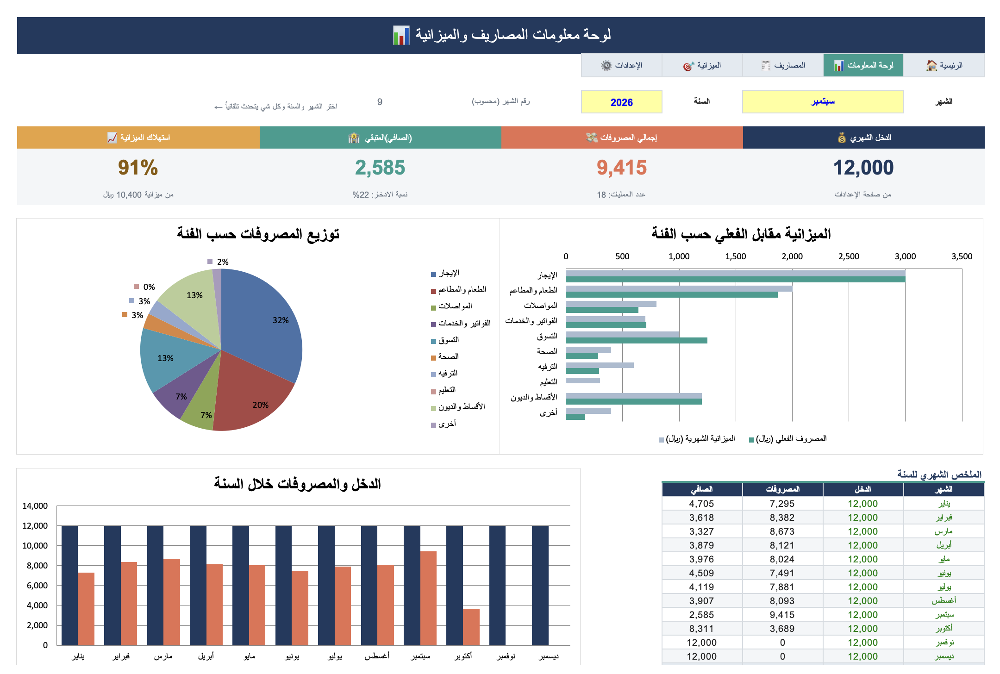
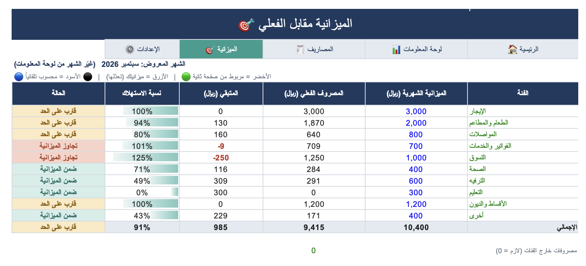
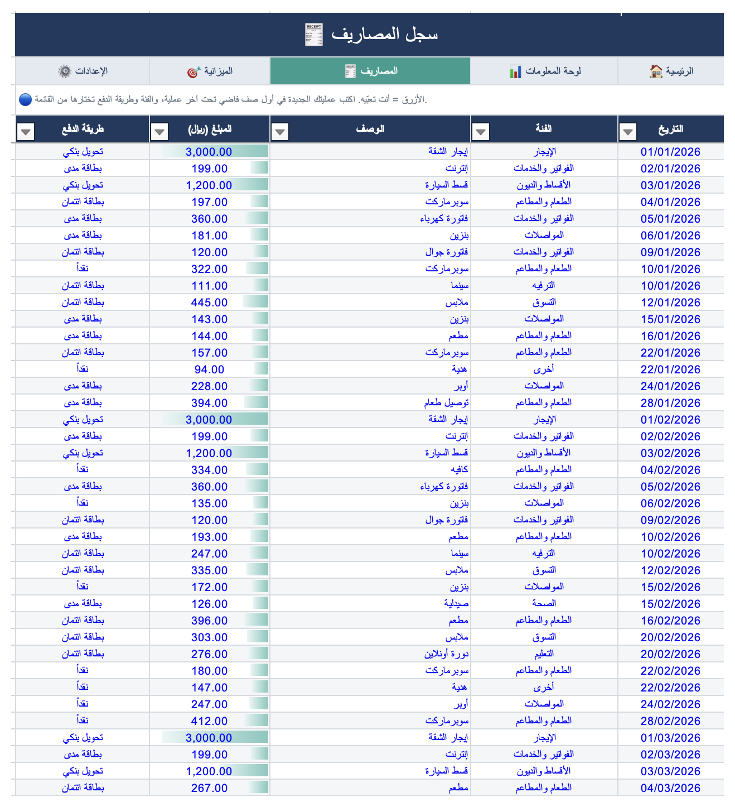

# Personal Expense & Budget Dashboard (Excel)

An interactive Excel dashboard for tracking personal expenses against a monthly budget. Pick a month and the whole dashboard updates: KPI cards, budget status per category, and charts.

**Author:** Joud

> **Note:** All transactions in this workbook are **synthetic sample data** (169 transactions, Jan to Oct 2026) created for demonstration. They are not real financial records.

## Preview

| Budget vs Actual | Expense Log |
|---|---|
|  |  |

## Features

- **Month and year selector.** A dropdown drives every number and chart on the dashboard.
- **KPI cards:** monthly income, total spending, remaining balance, and budget usage %.
- **Budget vs Actual** per category, with status flags: *Within budget*, *Near limit* (80%+), *Over budget* (100%+).
- **Charts:** budget vs actual by category (bar), spending distribution (pie), income vs spending across the year (column).
- **Expense log** with dropdown lists for category and payment method, plus date and amount validation.
- **Navigation bar** with internal hyperlinks between the five sheets, and the current page highlighted.
- **Settings sheet** for income, categories, and payment methods, so nothing is hardcoded in formulas.

## Workbook structure

| Sheet | Purpose |
|---|---|
| Home | Landing page with navigation buttons and usage steps |
| Dashboard | KPI cards, charts, and the monthly summary for the year |
| Expenses | Transaction log (date, category, description, amount, payment method) |
| Budget | Monthly budget per category vs actual spending |
| Settings | Monthly income and the dropdown lists |

*(Sheet names are in Arabic; the layout is right-to-left.)*

## Excel techniques used

- `SUMIFS` with date boundaries (`DATE`, `EDATE`) to aggregate spending by category and month
- `MATCH` to convert the selected month name into a month number
- `COUNTIFS`, `IFERROR`, `TEXT` for KPI notes and safe division
- Nested `IF` for budget status
- Data Validation (lists, dates, decimals)
- Conditional Formatting (status colors, data bars, negative values)
- Cross-sheet references and hyperlinks
- Charts: clustered bar, pie, clustered column

## Sample insights (September 2026)

- Total spending: **9,415** of a **10,400** budget (**91%** used), leaving **2,585** from a 12,000 income (about 22% saved).
- Two categories went over budget: **Shopping (125%)** and **Utilities (101%)**.
- Rent and loan installments are the largest fixed costs.

## How to use

1. Open `expenses_dashboard_final.xlsx` in Excel.
2. In **Settings**, set your monthly income and edit categories if needed.
3. In **Budget**, set a monthly amount per category (blue cells).
4. Log expenses in **Expenses** below the last row.
5. Open **Dashboard** and choose the month and year (yellow cells).

Color code: blue text = inputs you edit, black = formulas, green = links from other sheets.

## Tools

Microsoft Excel (Mac).
